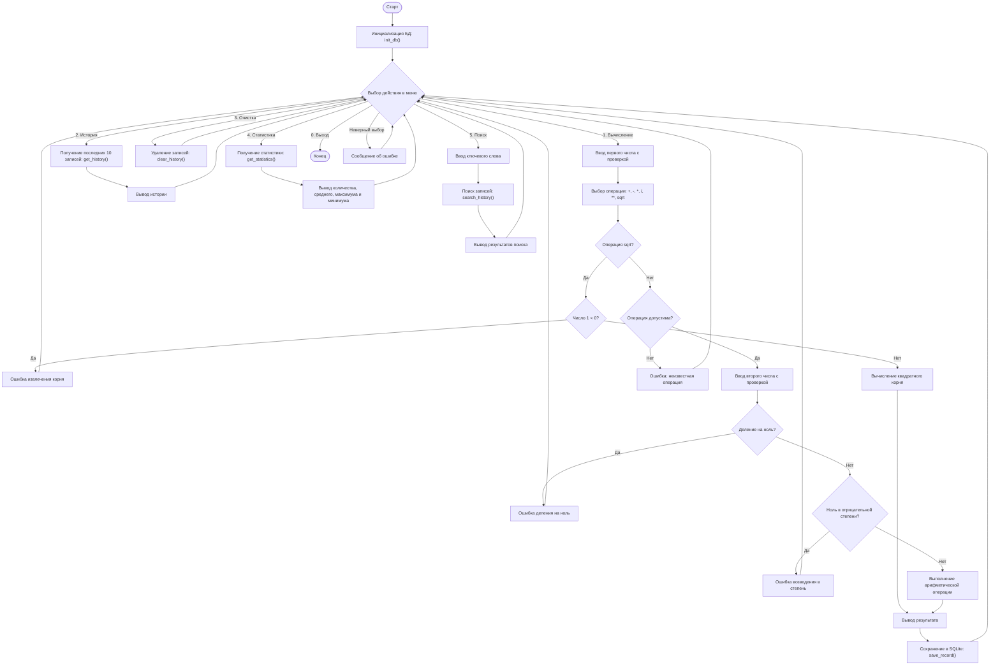
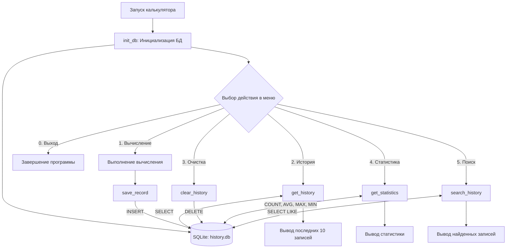

# Калькулятор

Консольная программа-калькулятор на Python 3.

## Возможности
- Сложение, вычитание, умножение, деление, возведение в степень
- Обработка ошибок ввода
- Обработка деления на ноль
- Обработка возведения нуля в отрицательную степень
- Хранение истории вычислений в БД и поиск по ней
- Статистика вычисений (кол-во, среднее, наибольшее и наименьшие значения)


## ▫ Алгоритм работы

Ниже представлена блок-схема основной логики калькулятора:




## Алгоритм работы БД

Ниже представлена блок схема работы БД:



## Требования
- Python 3.10+
- ОС РЕДОС (или другой Linux)

## Установка и запуск
1. Клонируйте репозиторий (или скопируйте папку)
2. Создайте виртуальное окружение:
python3 -m venv venv
3. Активируйте окружение:
source venv/bin/activate
4. Запустите программу:
python main.py


## Тестирование

Для автоматического тестирования математических функций
калькулятора используется библиотека `pytest`.

Тесты находятся в файле `test_calc_logic.py` и проверяют:
- Корректность выполнения арифметических операций
- Работу с положительными и отрицательными числами
- Обработку дробных чисел
- Граничные случаи (нулевые значения, деление без остатка)
- Обработку ошибок (деление на ноль)

### Запуск тестов

1. Перейдите в каталог проекта:

   ```bash
   cd ~/projects/calculator
   ```

2. Активируйте виртуальное окружение:

   ```bash
   source venv/bin/activate
   ```

3. Установите зависимости:

   ```bash
   python -m pip install -r requirements.txt
   ```

4. Запустите все тесты:

   ```bash
   python -m pytest -v
   ```

### Запуск отдельных тестов

Для проверки только функции вычисления остатка от деления:

```bash
python -m pytest -v test_calc_logic.py::TestModulo
```

Для запуска одного конкретного теста:

```bash
python -m pytest -v test_calc_logic.py::TestModulo::test_error
```

### Результаты тестирования

При выполнении тестов pytest выводит их результаты:

- `PASSED` — тест выполнен успешно
- `FAILED` — обнаружено несоответствие ожидаемому результату
- `ERROR` — ошибка при подготовке или выполнении теста

Если все тесты пройдены успешно, в конце отчёта
отображается сообщение вида:

```text
==================== 15 passed in 0.05s ====================
```

Количество тестов и время выполнения могут отличаться.


## Автор
[Можаев А.В.], группа [ПРз-23], 2026
