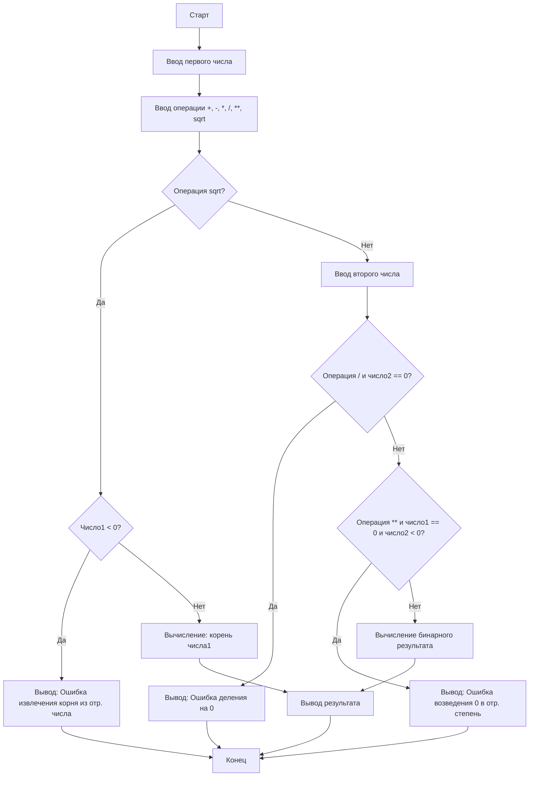

# Калькулятор

Консольная программа-калькулятор на Python 3.

## Возможности
- Сложение, вычитание, умножение, деление, возведение в степень
- Обработка ошибок ввода
- Обработка деления на ноль
- Обработка возведения нуля в отрицательную степень

## ▫ Алгоритм работы
 
Ниже представлена блок-схема основной логики калькулятора:

## Требования
- Python 3.10+
- ОС РЕДОС (или другой Linux)

## Установка и запуск
1. Клонируйте репозиторий (или скопируйте папку)
2. Создайте виртуальное окружение:
python3 -m venv venv
3. Активируйте окружение:
source venv/bin/activate
4. Запустите программу:
python main.py

## Автор
[Можаев А.В.], группа [ПРз-23], 2026
